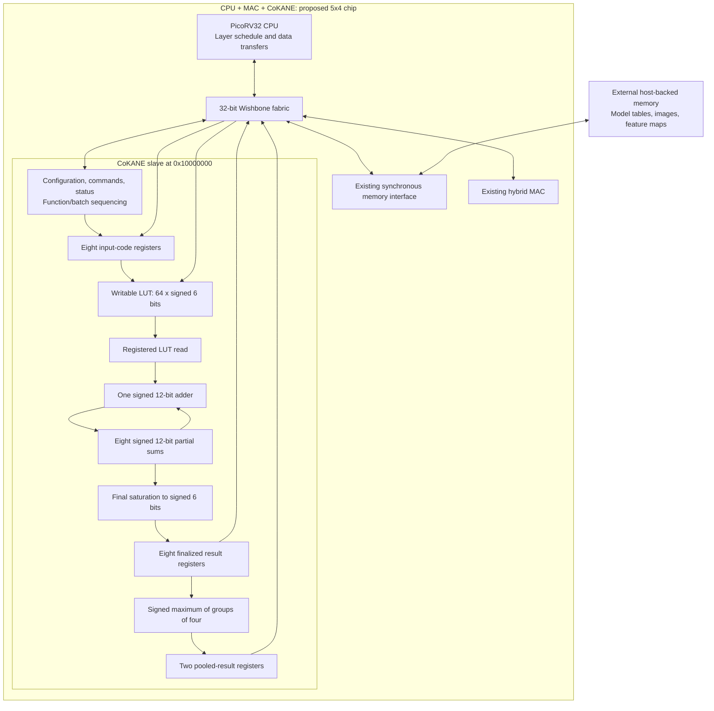

# CPU + MAC + CoKANE NPU specification

Revision: 0.1, 20 November 2026. Status: development specification; the integrated NPU is not physically qualified.

## 1. Purpose and fixed design choices

Implement a programmable, multiplier-free KAN lookup/reduction engine alongside the existing PicoRV32 CPU and hybrid MAC. The original FPGA CKAN implementation and `CKAN/NPU_3_O.pdf` are references, not drop-in ASIC RTL. The CPU+MAC release `cpu-mac-20mhz-3x4-v1` remains frozen.

| Item | Contract |
|---|---|
| Technology / footprint | SKY130A, 5x4 Tiny Tapeout tiles; this template exists in the bundled support tools |
| Clock | One synchronous 20 MHz clock, 50 ns target; no generated clocks |
| CPU / existing MAC | Preserve baseline CPU configuration and separate 8-bit operand / 24-bit hybrid MAC |
| CoKANE datapath | One registered lookup path and one signed 12-bit accumulator adder |
| LUT bank | 64 writable signed 6-bit entries: 384 bits / 48 bytes |
| Partial sums | Eight signed 12-bit registers: 96 bits / 12 bytes |
| Batch length | 1..8 output positions, fixed for one accumulation context |
| Contributions per output | 1..64, fixed for one context; reject commands beyond that count |
| LUT input | Raw 4-bit or 6-bit two's-complement codes, selected per context |
| LUT value / finalized output | Signed 6-bit, range -32..31 |
| Numerical saturation | Exactly once per output, after all contributions; never per channel or intermediate batch |
| Convolution profile | 3x3, stride 1, valid padding |
| Pooling profile | Signed 2x2 maximum, stride 2 |
| Classifier example | Dense KAN 50->10, then CPU argmax |
| Layers | Firmware reuses the same hardware; no physical compute instance per layer |
| Initial memory transport | CPU-driven Wishbone transfers; external memory is host-backed through the baseline pin protocol |

The storage subtotal of 60 bytes excludes eight input-code registers (6 bytes), eight result registers (6 bytes), two pooled-result registers, initialization masks, counters, bus/control registers, and all selection logic. It is not an ASIC area estimate. Writable tables are ordinary synthesizable storage until mapping and synthesis establish their physical cost; FPGA ROM attributes are not SRAM macros.

## 2. Top-level block diagram



No direct accelerator DMA or autonomous external-memory master is present in revision 0.1. Geometry, function IDs and tensor addresses are firmware descriptors; the hardware micro-job contains batch size, term count and input-code precision. This distinction must remain visible in documentation and performance claims.

## 3. Numerical contract

For output position `p`, hardware computes `PS[p] = sum_f LUT_f[input_code[f,p]]`, then `result[p] = clamp(PS[p], -32, 31)`. Every LUT entry is already quantized by the model exporter. Retain that per-edge quantization; remove intermediate arithmetic saturation of channel sums. A single arithmetic saturation point may span multiple clock stages.

For at most 64 signed 6-bit contributions, the sum is in [-2048, 1984], exactly representable by a signed 12-bit accumulator. No bias or additional scaling is included in this bound. More than 64 terms, bias additions, wider entries or requantization multipliers require a revised specification and overflow proof. The final contribution must be included before finalization.

LUT addresses use raw two's-complement input codes. A 6-bit address of 0 is input zero, 31 is +31, 32 is -32 and 63 is -1. For 4-bit mode, only addresses 0..15 are valid; 8 represents -8 and 15 represents -1. Bits above the 4-bit code must be zero in the input register. Exporters must reorder signed state enumeration into this code order. LUT writes use the low six bits; the hardware interprets those bits as signed values. Bus reads of numerical results are sign-extended to 32 bits.

Model normalization, learned input batch-normalization/bias, scale factors, rounding, clipping, function order and tensor order must be exported and independently checked. Taking a raw grayscale byte's low nibble is not equivalent to the trained input quantizer. Revision 0.1 provides integer execution, not a claim of reproduced MNIST accuracy.

## 4. Memory and execution schedule

The complete paper-profile tables are 216 bytes for conv1, 1,728 bytes for conv2 and 24,000 bytes for the 50->10 classifier, ideally bit-packed: 25,944 bytes total. They remain external. A 64x6 bank holds one full 6-bit-input function. Four 4-bit-input functions could theoretically fit, but multi-function packing is not implemented in revision 0.1; first-layer jobs use one function's first 16 entries.

For each batch of up to eight output positions of one output channel:

1. Configure `BATCH`, `TERMS` and `INPUT_BITS`; issue `BEGIN` to zero the eight partial sums and open a context.
2. Issue `LUT_CLEAR`, set `LUT_ADDR`, and load a function through `LUT_DATA` (auto-increment modulo 64).
3. Write one input code for each active batch lane; issue `ADD`. All required inputs and referenced LUT entries are checked before any partial sum changes.
4. Each lane performs a registered LUT read, then an accumulator update: two busy cycles per lane. Partial sums retain full precision while idle and during table reloads.
5. Wait for busy to clear. Repeat steps 2..4 for every contribution; input-valid flags are consumed by each successful `ADD`. A loaded table may be reused without clearing/reloading it if the next job uses the same function.
6. After exactly `TERMS` completed `ADD` operations, issue `FINALIZE`; one result is saturated per cycle. The context closes when all results are valid.
7. Optionally issue `POOL` for a batch of 4 or 8 finalized results. Consecutive groups of four must describe individual 2x2 spatial windows. Read pooled values and store them externally.

The CPU must wait until lookup/accumulation is idle before changing a table or input. The LUT bank is not double-buffered. There is no overlap of table loading and active lookup execution. Eight partial sums amortize function loads over eight convolution outputs; later batches still reload tables. For one image's dense classifier, use a batch of one class output and 50 contributions; there is no automatic eight-class reuse of a single function.

Feature maps use explicit channel-major `C,H,W` ordering in firmware and the reference model. Firmware gathers each tap using `function_id = out_channel*(Cin*9) + input_channel*9 + ky*3 + kx`. Pooling groups are assembled explicitly; odd convolution dimensions discard the last unpaired row/column. Initial external representation is one signed activation per byte (sign-extended), not dense six-bit packing.

## 5. Wishbone register ABI v0.1

Base address: `0x10000000`. Registers are word-aligned; only offsets within the first 256 bytes are implemented. Bus request acceptance is `cyc && stb && !ack`; an accepted transfer produces registered acknowledgment. Narrow register writes require byte lane `sel[0]`; writes with that lane disabled have no effect. Unknown/alignment-invalid reads return zero. Invalid low-byte-enabled writes set an error. Reads and polling are permitted while busy.

| Offset | Register | Meaning |
|---|---|---|
| 0x00 | ID | RO `0x434b0100` (CK ABI 1.0) |
| 0x04 | STATUS | bit0 busy, bit1 context active, bit2 done, bit3 sticky error, bit4 results valid, bit5 pooled results valid; error code in bits15:8 |
| 0x08 | COMMAND | WO command enumeration below |
| 0x0c | BATCH | RW 1..8, default 8; only between contexts |
| 0x10 | TERMS | RW 1..64, default 1; only between contexts |
| 0x14 | TERMS_DONE | RO successful contributions per lane in current/last context |
| 0x18 | COMPUTE_CYCLES | RO busy clock cycles since BEGIN; excludes idle CPU transfers |
| 0x1c | ELAPSED_CYCLES | RO context-active cycles since BEGIN, including CPU transfer gaps; saturates at 0xffffffff |
| 0x20 | LUT_ADDR | RW 0..63, write-data auto-increments after each accepted LUT_DATA write |
| 0x24 | INPUT_BITS | RW 4 or 6, default 6; only between contexts |
| 0x28 | LUT_DATA | RW current six-bit entry; unwritten entries read zero; read does not increment address |
| 0x2c | RESULT_COUNT | RO number of valid finalized results |
| 0x30 | POOL_COUNT | RO number of valid pooled results |
| 0x40..0x5c | INPUT[0..7] | RW raw input codes, one word per lane |
| 0x80..0x9c | PSUM[0..7] | RO sign-extended partial sums; debug values may change while busy |
| 0xc0..0xdc | RESULT[0..7] | RO sign-extended results; zero unless valid and lane < RESULT_COUNT |
| 0xe0..0xe4 | POOL_RESULT[0..1] | RO sign-extended pooled results; zero unless valid |

Commands: 1 BEGIN, 2 ADD, 3 FINALIZE, 4 ABORT, 5 CLEAR_ERROR, 6 POOL, 7 LUT_CLEAR. A command is an enumeration, not a bit mask. Low-byte values outside this list are invalid.

BEGIN requires idle, no active context and no sticky error. ADD requires an active context, a remaining contribution, and all active input/LUT references valid. FINALIZE requires exactly TERMS successful contributions. POOL requires 4 or 8 valid results. An error blocks further computational commands until CLEAR_ERROR or ABORT. CLEAR_ERROR preserves the context. ABORT is accepted even while busy, cancels the context and invalidates results/inputs, clears errors/counters/sums, but retains the LUT and configuration. No partially computed result becomes valid after abort.

All writes except ABORT while busy are rejected with BUSY error and cannot modify operands, LUTs, partial sums or configuration; an already-running operation continues. Configuration writes during a context are rejected. Table/input writes while idle may occur during a context. LUT_CLEAR clears entry-valid flags, not the table data bits. Invalid ADD validation is atomic: it changes no sums or contribution count. Reset clears all validity flags, sums and control state; uninitialized LUT contents cannot be consumed.

Error codes: 1 BUSY, 2 STATE, 3 CONFIG, 4 MISSING_DATA (input or referenced LUT entry), 5 ADDRESS, 6 COMMAND, 7 INPUT_CODE. Errors latch the most recent error code. Done is cleared by BEGIN/FINALIZE/POOL start and set by completed FINALIZE/POOL; ADD completion is observed by busy deassertion and TERMS_DONE.

## 6. Firmware example and generality

First validation profile: 28x28x1, 3x3 conv 1->2, pool to 13x13x2, 3x3 conv 2->2, pool to 5x5x2, flatten to 50 values, dense KAN 50->10, CPU argmax. Pooled feature storage is 338 bytes and 50 bytes using one byte per value. No full unpooled map is necessary when batches group pooling windows.

The firmware profile validates input images up to 32x32, convolution Cin up to 4 and Cout up to 32. Hardware does not parse those shapes; it enforces the 8-lane / 64-term / 4-or-6-bit micro-job limits. The layer count is limited by available external storage and firmware, not instantiated layers. Larger networks must obey the total-term bound; splitting into multiple ADD calls does not permit exceeding 64 contributions. No DMA, on-chip full-model memory, autonomous window generator, hardware line buffer, interrupt, softmax, on-chip training or FPGA streaming adapter is claimed.

## 7. Verification and implementation gates

1. Independent integer oracle, including cancellation cases that fail with per-channel saturation, both sum extremes, both saturation limits, 4/6-bit addressing and exact last-term handling.
2. Standalone Wishbone RTL regression: all batch lengths, 1/9/18/50/64 contributions, distinct nonconstant tables, table reload retention, input/table validity, byte enables, invalid commands/configuration/addresses, reset and abort during every operation, held bus requests, result retention, cycle counts and signed pooling.
3. CPU pin-interface firmware regression: existing MAC tests plus CoKANE accesses through the actual CPU/decoder and host-memory stalls. Old reserved-CoKANE read-zero expectation must become an ID check. A wrong expected result must fail.
4. Independent convolution/pooling/dense reference scheduling; compare each intermediate tensor. A matching selected checkpoint and corrected exporter are required before claiming model accuracy.
5. Standalone and integrated synthesis, no inferred latches, no undriven/multiple-driven nets, evidence bound to source hashes. Report LUT-bank/control area before adding storage or parallel lanes.
6. A new 5x4 physical flow from RTL: nine-corner STA at 50 ns, electrical limits, routing/Magic/KLayout DRC, LVS, antenna checks and all Tiny Tapeout prechecks. Historical instance-specific baseline ECO scripts are not valid for the new netlist. Functional gate simulation follows the exact new netlist. SDF remains outside the previously agreed verification scope.

Performance reports must distinguish compute cycles, context elapsed cycles, table/data transport, CPU window gathering, pooling, and complete image latency. No FPGA frequency, throughput or accuracy number is inherited by this ASIC.

## 8. Development sources and status

Active implementation: `CoKANE/`, branch `feature/cokane-programmable`, derived from frozen CPU+MAC tag. `CKAN/` remains the supplied reference. The copy of this document at `CoKANE/NPU_Specs.md` is committed with the implementation; keep the root copy synchronized.

Milestone 1: the lookup/reduction/pooling RTL, CPU integration, firmware register helpers and synthetic tensor reference schedule are implemented. The C layer scheduler is implemented and verified in milestone 2; trained-model export remains future work. A source build or passing RTL regression is not physical qualification.

## 9. First build milestone (20 November 2026)

| Check | Observed result |
|---|---|
| Standalone RTL | PASS: three test groups; arithmetic/protocol, full synthetic 28x28 two-layer profile with 50->10 head, and reset/abort/bus boundaries |
| CPU integration | PASS: two pin-only firmware boots with random host waits; both reset paths; existing MAC checks retained; deliberately wrong expectation rejected |
| Saturation negative control | PASS: unchanged test rejects a deliberately broken RTL mutant that clips 62 to 31 during accumulation |
| Mapped engine functional simulation | PASS: arithmetic/protocol regression against the exact mapped standalone netlist; no SDF |
| C firmware header | PASS: C11 syntax with gcc -Wall -Wextra -Werror; not a compiled full inference program |
| Filtered SKY130 synthesis | PASS: no latches/unmapped logic; engine 3,741 cells, 47,658.208 square micrometres; combined 17,708 Yosys-counted cells, 174,172.0448 square micrometres |
| Physical timing/layout | NOT RUN for this integrated prototype |
| Trained-model accuracy | NOT VERIFIED; tensor tests use deterministic synthetic tables |

Area includes mapped storage, selection and control logic, not only the 60-byte core subtotal. Engine mapping uses the default ABC strategy; the combined first footprint estimate uses ABC fast mapping. Both exclude the pinned PDK synthesis/placement exclusion lists. These values exclude placement, clock-tree/hold/electrical repair, antenna diodes and filler. They establish a starting point, not physical fit or 20 MHz timing closure. `evidence/cokane/prototype-validation.json` binds results to source and report hashes.

On the existing development server, from `/home/jagat/.sys/cokane-soc/cokane-dev`:

```sh
bash scripts/test-cokane.sh
bash scripts/test-cokane-cpu.sh
bash scripts/test-cokane-negative.sh
bash scripts/synth-cokane.sh
bash scripts/test-cokane-synth-gl.sh
python3 scripts/check-cokane-milestone.py
```

The server reuses the baseline Python environment through an ignored `.venv` symlink. CAD/PDK installations remain outside Git. Synthesis reproduces from the pinned library; mapped artifacts are in ignored `verification/cokane-synth/`. Historical baseline ECO scripts are unused. The frozen qualification branch uses a fresh 5x4 implementation and new qualification evidence.

## 10. Compiled CPU firmware milestone (20 November 2026)

`firmware/cokane_scheduler.c` implements checked convolution+pool and dense descriptors. Firmware gathers windows, batches two pooling windows (eight convolution positions), handles final four-lane batches, preserves wide sums across function reloads, finalizes once, and stores channel-major signed-byte feature maps externally. Dense jobs use one class output per context; argmax selects the first maximum on ties.

Descriptors contain dimensions, pointers and buffer lengths. Unsupported shapes/precision, undersized buffers, input/output or table/output aliases, and out-of-range quantized values are rejected before device writes. A busy/active device belongs to its caller and is not aborted by another layer call. Polling has a bounded number of status reads. An error/timeout during owned work issues ABORT; discard the entire layer's possibly partial output. No concurrent access lock or hardware bus-acknowledgment timeout is supplied. `ck_scheduler_init` requires a valid context pointer.

### Selective LUT loading

The bank need not contain all 64 entries if a job references fewer codes. Revision 0.2 firmware streams all 16 entries for a four-bit function, but for six-bit functions loads only the distinct codes needed by the current batch. It clears entry-valid flags before each function and writes each selected address/value pair once. All active input references must still pass hardware validity checks before ADD. The fixed 64x6 physical bank and RTL are unchanged; partial sums still retain full precision.

This reduces traffic, not the size of the externally stored model. The CPU-only baseline can look up entries directly in external memory and performs no CoKANE transfers.

### Verification and performance

Thirty native compiled-C cases cover shapes, signed data, odd dimensions, partial batches, buffer aliases, invalid descriptors/quantization, ownership, error/timeout cleanup, and a complete synthetic network. A freestanding RV32E/ILP32E binary then executes both the scheduler and a straightforward CPU-only reference on the unchanged CPU+MAC+CoKANE RTL. Both paths match the independent Python oracle for all 338 first-layer features, 50 second-layer features, ten scores and argmax. Actual NPU MMIO transaction counters match firmware instrumentation.

The example is 28x28, two 3x3/stride-1 convolution + 2x2/stride-2 pooling layers, then a 50->10 KAN head. Tables and already-quantized signed input pixels are synthetic. This is not MNIST accuracy validation and excludes raw-image preprocessing.

Verilator runs a simulation-only 256 KiB RAM on the existing external-memory bus with reproducible 0..3-cycle added waits. This RAM is outside the chip and adds no ASIC memory. It does not model the pin-level host's complete serialization and response delay. Separate pin-interface regressions remain valid.

| Same synthetic workload at nominal 20 MHz | Measurement |
|---|---:|
| Accelerator scheduler, initial full-table loading | 751.05525 ms |
| Accelerator scheduler, selective six-bit loading | 700.47725 ms |
| Straightforward CPU-only reference, latest run | 462.8764 ms |
| Accelerator busy clocks / nominal busy time | 34,486 / 1.7243 ms |
| Hardware micro-jobs | 206 |
| LUT entry writes, full / selective | 86,432 / 27,976 |
| NPU MMIO writes, full / selective | 111,420 / 55,492 |
| Scheduler NPU reads, selective | 3,713 |
| Input-code writes / output values read | 16,268 / 398 |

Despite 67.6% fewer LUT entry writes, selective loading improves this instrumented scheduler's elapsed time by only about 6.7%. It remains about 1.51 times slower than the straightforward CPU-only reference for this fixture and RAM model. No acceleration benefit has been established. Firmware instruction/data traffic, gathering, validation, instrumentation and device transfers dominate; the core adder's busy time is not end-to-end inference latency. The hardware phase includes boot/setup and report preparation; the CPU-only phase runs afterward with its own range scans. Neither is a tuned production implementation. No silicon frequency/timing claim follows from these nominal-clock conversions.

`evidence/cokane/inference-validation.json` records both phase cycle counts, combined program external-memory counters, scores and source hashes. `inference-full-table-validation.json` and `inference-full-table-build.json` retain the original full-table comparison; source commit `b542947` reproduces that policy. The current build record identifies the exact selective-loading source and firmware.

Reproduce on the server with `bash scripts/test-inference.sh`. It builds RV32E C (no M/C extensions), generates deterministic data, checks native C against an independent oracle, executes the binary on the real SoC RTL, and compares all intermediate tensors. Verilator is the default; `SIM=icarus` is a slower alternative. See `firmware/cokane_scheduler.h`, `firmware/inference_main.c`, and `firmware/inference_reference.c`.

The user has deferred performance improvement and trained-model accuracy. The exact working prototype is now frozen for digital block qualification in 5x4 tiles at 20 MHz; see SIGNOFF.md. Hardware RTL and firmware remain unchanged throughout this qualification.

## 11. Preserved prototype and final qualification

Tag `cokane-working-prototype-v0.2` identifies commit `db530b7fe46207c3720513d0c4b0d0d69ce45dee`. A separate performance worktree, Git bundle, full prototype archive and SHA-256 manifest preserve this starting point. `scripts/check-frozen-prototype.py` rejects changes to the frozen RTL, firmware and fixture generator.

The qualification branch closes physical implementation at the existing electrical limits, verifies all nine RC/PVT corners, and runs the exact final gate netlist through both basic firmware and full compiled pin-host inference. The additional all-zero LUT model checks that a valid but uninformative classifier still completes. Model usefulness and integer execution correctness are separate validation targets. All 15 Tiny Tapeout prechecks and artifact-bound reports are required; the detailed sequence and exclusions are in SIGNOFF.md.

### Qualified frozen milestone

Run `ck-signoff-r4` passed the declared 5x4 / 20 MHz digital block qualification. Worst extracted setup/hold slacks: +0.419117 / +0.129389 ns. All nine timing corners, electrical limits, DRC/LVS/antenna, 15 prechecks, basic gate firmware and complete synthetic/zero-model pin-host gate inference passed. See SIGNOFF.md and `evidence/qualification-ck-signoff-r4.json` for hashes and exact scope. Trained accuracy and performance improvements are deferred.
