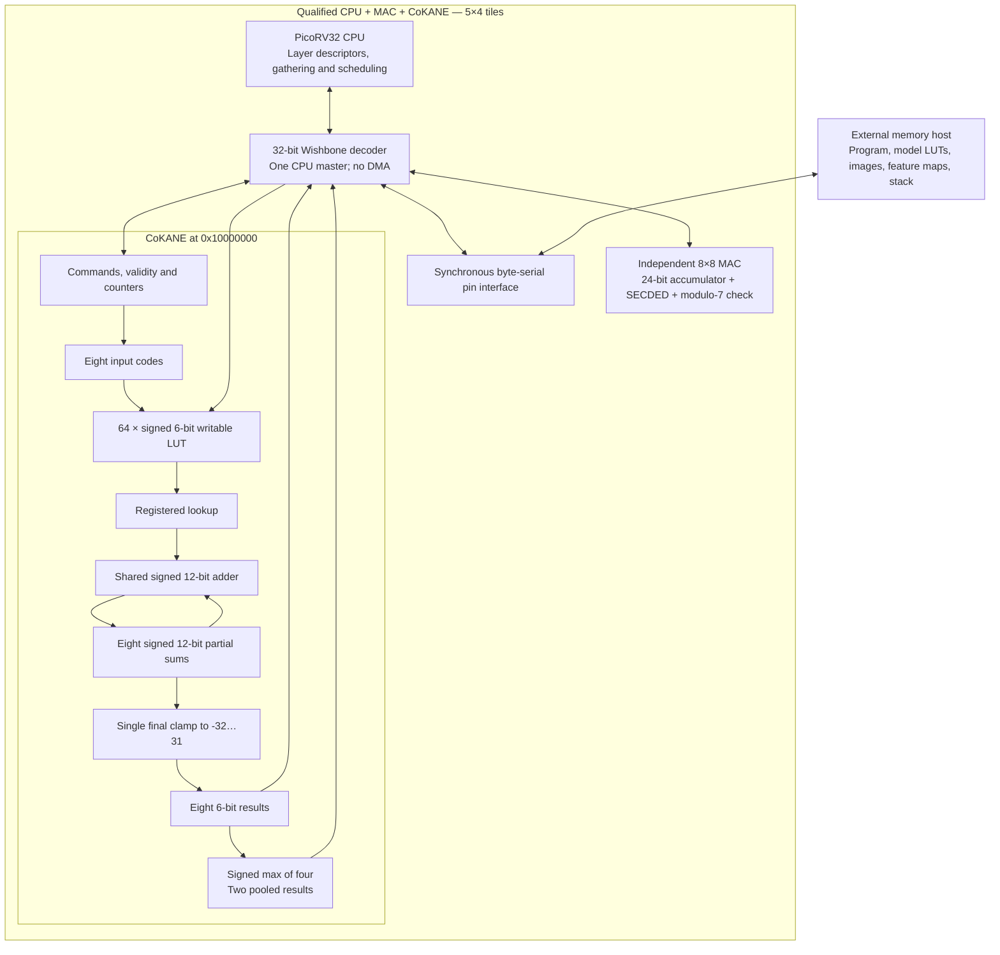

# CPU + MAC + CoKANE chip specification

Revision 1.0 — 21 November 2026. Canonical specification for the frozen SKY130 integrated chip.

## Quick reference

| Property | Implemented value |
|---|---|
| Top / process | `tt_um_cokane_soc`; SKY130A, `sky130_fd_sc_hd` |
| Footprint | 5×4 Tiny Tapeout tiles (20 tiles) |
| Final GDS boundary | 856.52 × 511.36 µm; **437,990.0672 µm² = 0.4379900672 mm²** |
| Clock / reset | Single rising-edge 20 MHz / 50 ns clock; synchronous active-low reset qualified by `ena` |
| CPU | PicoRV32 Wishbone, 32-bit datapath/address, 16 integer registers, RV32E/ILP32E firmware |
| Separate MAC | Signed 8×8 product; signed 24-bit wrapping accumulator; SECDED storage and modulo-7 arithmetic checking |
| CoKANE | One 64×6-bit writable LUT, one registered lookup/12-bit adder path, eight partial sums |
| CoKANE limits | 1–8 lanes, 1–64 contributions, raw signed 4/6-bit input codes, signed 6-bit outputs |
| Saturation / pooling | One final clamp per output; signed maximum of groups of four |
| Program, model and feature memory | External host-backed memory; no on-chip program RAM, boot ROM or model SRAM |
| Firmware convolution | 3×3 valid, stride 1; 2×2 max pooling, stride 2 |
| Model status | Synthetic and all-zero integer execution verified; trained recognition accuracy unverified |

## Architecture



The CPU executes all layer scheduling and external transfers. Tensor dimensions and pointers are firmware descriptors; CoKANE accepts only small accumulation jobs. The MAC is a separate MMIO peripheral and is not needed by the lookup/add KAN path. No autonomous window generator, DMA, cache, MMU, interrupt completion, softmax or training engine is implemented.

## CPU, boot and reset

The instance in `src/soc_core.v` selects PicoRV32's Wishbone wrapper with 16 registers (`x0`–`x15`, `x0=0`) and dual-port register access. It disables counters, 64-bit counters, registers 16–31, multiplication, division, IRQ, compressed instructions, barrel shifting and two-stage shifting. PCPI, fast multiplication, trace, two-cycle ALU and two-cycle compare remain disabled defaults. Shifts are iterative. No complete ISA compliance certification or fixed IPC is claimed.

Illegal-instruction and misalignment catching are disabled: firmware must use supported instructions and aligned accesses. The external MAC does not add a CPU MUL instruction. Interrupt input is tied low; completion is polled. Register-file zero initialization is disabled, so software must initialize the registers it uses.

Reset PC and hardware stack-address parameter are zero. The host must serve valid instruction words starting at address `0x00000000`. Reference startup code sets SP to `_stack_top = 0x0003fff0`, clears `.bss`, then calls `main`; reset does not load a program automatically. Build firmware with `-march=rv32e -mabi=ilp32e`.

The wrapper applies `rst_n & ena` as the active-low synchronous reset. Hold the design selected/enabled and apply clock edges with reset low; the host uses eight reset edges. Release reset while clock is low before continuing. There is no PLL or internal clock source.

## Fabric and memory map

One 32-bit Wishbone CPU master carries instruction and data traffic. Data is little-endian with four byte enables. CoKANE and MAC return registered acknowledgment on `cyc && stb && !ack`.

| Address range | Target / behavior |
|---|---|
| `0x00000000`–`0x0fffffff` | External host memory region; acknowledgment must come from host |
| `0x10000000`–`0x1fffffff` | CoKANE; only first 256 bytes accepted, word alignment required |
| `0x20000000`–`0x2fffffff` | MAC; word selection uses address bits 4:2, mirrored every 32 bytes |
| `0x40000000`–`0x4fffffff` | Peripheral placeholder, zero reads and immediate acknowledgment |
| Other regions | Zero reads and immediate acknowledgment; no access-fault response |

The external region is a 256 MiB address window, **not on-chip memory capacity**. The reference host implements 256 KiB (`0x00000000`–`0x0003ffff`). Program/data/`.bss` must fit below `0x0002e000` under the reference linker assertion; the inference report is at `0x00030000`. Stack space and host memory availability must be considered separately.

A missing external acknowledgment stalls the CPU indefinitely. Firmware polling bounds cannot recover a stalled instruction fetch or bus transfer. Ordinary SPI RAM cannot be wired directly to this custom interface.

## Independent protected MAC

The independent fault-tolerant MAC unit is [mac-sentry](https://github.com/Gargantuan5k/mac-sentry-ttsky26e), developed by [Siddharth Vivek](https://github.com/Gargantuan5k), [Tejas Singh Kohli](https://github.com/TejasKohlii/) and [Arohi Mehta](https://github.com/arohimehta123). Detailed documentation can be found at the source repository.


The [Wishbone wrapper](src/mac_wb.v) exposes the MAC Sentry hybrid core to the CPU. The [source provenance record](evidence/source-provenance.json) identifies the imported upstream revision. Operands are signed 8-bit values; multiplication produces a signed 16-bit product. Successful operations add to a signed 24-bit accumulator **modulo 2²⁴**, range −8,388,608…8,388,607. There is no saturation or accumulator-overflow flag.

Accumulator storage uses 30 bits: 24 data bits, five Hamming parity bits and one overall parity bit. The shortened extended Hamming code corrects a single storage-bit error and detects a double-bit error, with scrubbing during idle or operation. A separate modulo-7 predictor checks the full sign-extended 25-bit arithmetic candidate before its low 24 bits are committed. Residue value 7 is invalid. An arithmetic mismatch permits at most two retries after the initial attempt; a failed attempt does not commit a new sum.

Storage uncorrectable error completes with error 1; retry exhaustion completes with error 2 and no valid result. Operands are captured on accepted start and remain stable internally while busy. The next busy edge checks/commits the candidate, but bus handshakes and status capture add latency. This is not an end-to-end one-cycle operation.

| Offset from `0x20000000` | Register | Contract |
|---|---|---|
| `0x00` | A | RW low 8 bits; read zero-extended raw pattern |
| `0x04` | B | RW low 8 bits; read zero-extended raw pattern |
| `0x08` | CTRL | WO bit 0 START, bit 1 CLEAR; flags, not command enumeration |
| `0x0c` | STATUS | bit 0 busy; bit 1 done; bit 2 valid; bits 4:3 error; bit 5 corrected; bit 6 detected; bit 7 retried; bits 9:8 retry count |
| `0x10` | ACC | RO signed 24-bit accumulator sign-extended to 32 bits |

Writes require `sel[0]`. Unknown words read zero; low two address bits are ignored. Start during busy is ignored; clear is effective only while idle. Use separate clear/start operations and poll readiness. Nonzero control writes clear wrapper completion flags; completed status remains sticky until the next such write, not read-to-clear. Check done, valid and error before consuming ACC. Wrapper A/B writes while busy do not change saved operands.

### Verification and limits

The integrated firmware clears the accumulator, issues three signed MAC operations through the CPU, and checks both completion status and the successive sums of −12, 9,988 and −6,268. The gate-level simulation of the integrated chip passed this test. [Firmware test](test/test.py) · [Recorded gate-level result](evidence/gl-ck-signoff-r4-results.xml)

The upstream MAC Sentry RTL regression injects faults into accumulator storage, the arithmetic candidate, the checker, and the commit path. A corrupted saved operand can feed both the arithmetic and prediction paths, allowing them to agree on a wrong result. Correlated faults can also make a wrong candidate match the predicted residue. After a successful check, corruption before SECDED encoding can store a wrong sum with a valid codeword. [Upstream fault model](https://github.com/Gargantuan5k/mac-sentry/blob/85ddffb1a075da11f08c6ae78307abfb2458ea0a/spec/hybrid_mac.md) · [Upstream fault-injection results](https://github.com/Gargantuan5k/mac-sentry/blob/85ddffb1a075da11f08c6ae78307abfb2458ea0a/research/hybrid_validation.md)

This protection covers the stated accumulator/arithmetic mechanisms, not the whole chip. Modulo-7 checking can miss arithmetic differences divisible by seven; SECDED does not protect arbitrary multi-bit errors. Production fault-injection inputs are tied off and not exposed at pins. No radiation or silicon fault-rate guarantee is established.

## CoKANE numerical contract

For output position `p`, hardware computes `PS[p] = sum_f LUT_f[input_code[f,p]]`, then `result[p] = clamp(PS[p], -32, 31)`. Every LUT entry is already quantized by the model exporter. Retain that per-edge quantization; remove intermediate arithmetic saturation of channel sums. A single arithmetic saturation point may span multiple clock stages.

For at most 64 signed 6-bit contributions, the sum is in [-2048, 1984], exactly representable by a signed 12-bit accumulator. No bias or additional scaling is included in this bound. More than 64 terms, bias additions, wider entries or requantization multipliers require a revised specification and overflow proof. The final contribution must be included before finalization.

LUT addresses use raw two's-complement input codes. A 6-bit address of 0 is input zero, 31 is +31, 32 is -32 and 63 is -1. For 4-bit mode, only addresses 0..15 are valid; 8 represents -8 and 15 represents -1. Bits above the 4-bit code must be zero in the input register. Exporters must reorder signed state enumeration into this code order. LUT writes use the low six bits; the hardware interprets those bits as signed values. Bus reads of numerical results are sign-extended to 32 bits.

Model normalization, learned input batch-normalization/bias, scale factors, rounding, clipping, function order and tensor order must be exported and independently checked. Taking a raw grayscale byte's low nibble is not equivalent to the trained input quantizer. The chip provides integer execution, not a claim of reproduced MNIST accuracy.

## CoKANE memory and execution schedule

The complete paper-profile tables are 216 bytes for conv1, 1,728 bytes for conv2 and 24,000 bytes for the 50->10 classifier, ideally bit-packed: 25,944 bytes total. They remain external. A 64x6 bank holds one full 6-bit-input function. Four 4-bit-input functions could theoretically fit, but multi-function packing is not implemented; first-layer jobs use one function's first 16 entries.

For each batch of up to eight output positions of one output channel:

1. Configure `BATCH`, `TERMS` and `INPUT_BITS`; issue `BEGIN` to zero the eight partial sums and open a context.
2. Issue `LUT_CLEAR`, set `LUT_ADDR`, and load a function through `LUT_DATA` (auto-increment modulo 64).
3. Write one input code for each active batch lane; issue `ADD`. All required inputs and referenced LUT entries are checked before any partial sum changes.
4. Each lane performs a registered LUT read, then an accumulator update: two busy cycles per lane. Partial sums retain full precision while idle and during table reloads.
5. Wait for busy to clear. Repeat steps 2..4 for every contribution; input-valid flags are consumed by each successful `ADD`. A loaded table may be reused without clearing/reloading it if the next job uses the same function.
6. After exactly `TERMS` completed `ADD` operations, issue `FINALIZE`; one result is saturated per cycle. The context closes when all results are valid.
7. Optionally issue `POOL` for a batch of 4 or 8 finalized results. Consecutive groups of four must describe individual 2x2 spatial windows. Read pooled values and store them externally.

The CPU must wait until lookup/accumulation is idle before changing a table or input. The LUT bank is not double-buffered. There is no overlap of table loading and active lookup execution. Eight partial sums amortize function loads over eight convolution outputs; later batches still reload tables. For one image's dense classifier, use a batch of one class output and 50 contributions; there is no automatic eight-class reuse of a single function.

Feature maps use explicit channel-major `C,H,W` ordering in firmware and the reference model. Firmware gathers each tap using `function_id = out_channel*(Cin*9) + input_channel*9 + ky*3 + kx`. Pooling groups are assembled explicitly; odd convolution dimensions discard the last unpaired row/column. Initial external representation is one signed activation per byte (sign-extended), not dense six-bit packing.

## CoKANE register ABI v1.0

Base address: `0x10000000`. Registers are word-aligned; only offsets within the first 256 bytes are implemented. Bus request acceptance is `cyc && stb && !ack`; an accepted transfer produces registered acknowledgment. Narrow register writes require byte lane `sel[0]`; writes with that lane disabled have no effect. Unknown/alignment-invalid reads return zero. Invalid low-byte-enabled writes set an error. Reads and polling are permitted while busy.

| Offset | Register | Meaning |
|---|---|---|
| 0x00 | ID | RO `0x434b0100` (CK ABI 1.0) |
| 0x04 | STATUS | bit0 busy, bit1 context active, bit2 done, bit3 sticky error, bit4 results valid, bit5 pooled results valid; error code in bits15:8 |
| 0x08 | COMMAND | WO command enumeration below |
| 0x0c | BATCH | RW 1..8, default 8; only between contexts |
| 0x10 | TERMS | RW 1..64, default 1; only between contexts |
| 0x14 | TERMS_DONE | RO successful contributions per lane in current/last context |
| 0x18 | COMPUTE_CYCLES | RO busy clock cycles since BEGIN; excludes idle CPU transfers |
| 0x1c | ELAPSED_CYCLES | RO context-active cycles since BEGIN, including CPU transfer gaps; saturates at 0xffffffff |
| 0x20 | LUT_ADDR | RW 0..63, write-data auto-increments after each accepted LUT_DATA write |
| 0x24 | INPUT_BITS | RW 4 or 6, default 6; only between contexts |
| 0x28 | LUT_DATA | RW current six-bit entry; unwritten entries read zero; read does not increment address |
| 0x2c | RESULT_COUNT | RO number of valid finalized results |
| 0x30 | POOL_COUNT | RO number of valid pooled results |
| 0x40..0x5c | INPUT[0..7] | RW raw input codes, one word per lane |
| 0x80..0x9c | PSUM[0..7] | RO sign-extended partial sums; debug values may change while busy |
| 0xc0..0xdc | RESULT[0..7] | RO sign-extended results; zero unless valid and lane < RESULT_COUNT |
| 0xe0..0xe4 | POOL_RESULT[0..1] | RO sign-extended pooled results; zero unless valid |

Commands: 1 BEGIN, 2 ADD, 3 FINALIZE, 4 ABORT, 5 CLEAR_ERROR, 6 POOL, 7 LUT_CLEAR. A command is an enumeration, not a bit mask. Low-byte values outside this list are invalid.

BEGIN requires idle, no active context and no sticky error. ADD requires an active context, a remaining contribution, and all active input/LUT references valid. FINALIZE requires exactly TERMS successful contributions. POOL requires 4 or 8 valid results. An error blocks further computational commands until CLEAR_ERROR or ABORT. CLEAR_ERROR preserves the context. ABORT is accepted even while busy, cancels the context and invalidates results/inputs, clears errors/counters/sums, but retains the LUT and configuration. No partially computed result becomes valid after abort.

All writes except ABORT while busy are rejected with BUSY error and cannot modify operands, LUTs, partial sums or configuration; an already-running operation continues. Configuration writes during a context are rejected. Table/input writes while idle may occur during a context. LUT_CLEAR clears entry-valid flags, not the table data bits. Invalid ADD validation is atomic: it changes no sums or contribution count. Reset clears all validity flags, sums and control state; uninitialized LUT contents cannot be consumed.

Error codes: 1 BUSY, 2 STATE, 3 CONFIG, 4 MISSING_DATA (input or referenced LUT entry), 5 ADDRESS, 6 COMMAND, 7 INPUT_CODE. Errors latch the most recent error code. Done is cleared by BEGIN/FINALIZE/POOL start and set by completed FINALIZE/POOL; ADD completion is observed by busy deassertion and TERMS_DONE.


## Storage and firmware layer descriptors

The 48-byte LUT and 12-byte partial-sum bank are standard-cell storage, not SRAM macros. Additional payload includes eight 6-bit input codes (6 bytes), eight 6-bit results (6 bytes), two 6-bit pooled results (12 bits), the registered lookup value, 64 LUT-valid bits, eight input-valid bits, configuration, counters and control. The 60-byte LUT-plus-sum subtotal is not total engine storage or physical area.

Only **one complete 64-entry function** resides in the bank at a time in six-bit mode. Four-bit mode uses the first 16 entries for one function; multi-function packing is not implemented. Sixteen entries do not mean sixteen functions. Partial sums persist while the CPU invalidates/reloads the table for successive functions. No simultaneous table loading and active computation, or double buffering, is provided.

`firmware/cokane_scheduler.c` implements checked CPU-loaded descriptors. Convolution input width/height are 4–32, input channels 1–4, output channels 1–32, precision 4 or 6 bits. Fixed 3×3 kernels require `9*Cin` contributions (at most 36 in this firmware profile). Dense descriptors support 1–64 input features and 1–32 outputs. These are firmware limits inside the hardware's 64-term bound, not programmable hardware convolution geometry.

The scheduler groups two pooling windows into eight lanes, or one window into four lanes. Dense classification uses one output class per context, followed by CPU argmax with first-index tie-breaking. Layers reuse the same device and external feature buffers; there is no fixed layer count in hardware. No implicit extra bias, scaling, rounding or requantization multiplier is present.

Descriptor pointers, lengths, aliases, shapes and quantized values are checked before writes. Output must not overlap input or model tables. A busy device belongs to its current caller; another call returns busy without aborting it. Errors/timeouts during owned work issue ABORT, and the caller must discard the whole possibly partially written output layer. `poll_limit` bounds status reads, not wall time, and does not solve absent bus acknowledgment. Concurrent callers require external serialization.

Four-bit functions load all 16 entries. Six-bit functions load only distinct input codes referenced by the current batch, after LUT_CLEAR. This reduces transfers while retaining hardware validity checks; full function tables remain in external memory.

### MNIST-shaped example, not a trained accuracy claim

| Stage | Shape / storage |
|---|---|
| Quantized input | 28×28×1, four-bit codes stored one per byte: 784 bytes |
| Conv 1 + pool | 3×3, 1→2 channels; 26×26 convolution, then 13×13×2: 338 bytes |
| Conv 2 + pool | 3×3, 2→2 channels; 11×11 convolution, then 5×5×2: 50 bytes |
| Classifier | Flatten 50; dense KAN 50→10; 10 signed-byte scores and CPU argmax |

Channel-major `C,H,W` maps are stored externally. Odd convolution dimensions drop the unpaired last row/column at pooling. Batching avoids storing the entire unpooled map.

| Example model functions | Actual signed-byte table storage | Hypothetical packed six-bit storage |
|---|---:|---:|
| Conv 1: `2*1*9*16` | 288 bytes | 216 bytes |
| Conv 2: `2*2*9*64` | 2,304 bytes | 1,728 bytes |
| Dense: `10*50*64` | 32,000 bytes | 24,000 bytes |
| Total | **34,592 bytes** | 25,944 bytes |

Packed model storage is not implemented. Code, stack, images, feature maps and tables all consume external memory. A model with poor accuracy still returns integer scores when valid and adequately serviced. Frozen synthetic scores are `[7,14,0,-6,7,-9,-2,0,-11,9]`, prediction 1; all-zero tables produce zero tensors/scores and prediction 0. Neither fixture establishes trained MNIST recognition accuracy.

## Pins and external host protocol

Tiny Tapeout supplies `clk`, `rst_n`, `ena`, eight UI pins, eight UO pins and eight UIO pins. The shared shuttle pad ring is outside this macro; no separate custom pad ring is included.

| Signal | Meaning |
|---|---|
| `ui_in[1:0]` | Byte lane, 0 least significant |
| `ui_in[2]` | Capture `uio_in` byte on clock rising edge |
| `ui_in[3]` | External memory acknowledgment |
| `ui_in[4]` | Select write-data byte instead of address byte on UO |
| `ui_in[5]` | Override UO with status |
| `ui_in[7:6]` | Reserved, drive zero |
| `uo_out[7:0]` in status mode | `{trap, cyc_ext, stb_ext, we, sel[3:0]}` |
| `uo_out` otherwise | Selected address or write-data byte |
| `uio_in[7:0]` | Host-to-chip read-data byte |
| `uio_out`, `uio_oe` | Both zero; all eight ASIC UIO pads are inputs |

Host transaction sequence:

1. Poll status (`ui=0x20`); bits 6:5 both high identify an external request. Trap bit 7 is diagnostic failure.
2. Select lanes 0–3 and read the four address bytes without clock edges. For writes, select `0x10|lane`, read data, and update aligned host memory using SEL byte enables.
3. For reads, drive each returned byte on UIO and clock once with `ui=0x04|lane` to capture it.
4. Clock once with ACK (`ui=0x08`), then clear control and clock once. Continue serving requests.

Controls and data must meet synchronous setup/hold requirements. There is no general asynchronous CDC adapter. The reference host changes inputs with clock low and uses slow manual edges, nominally at least 20 µs setup/high/hold intervals. This is not a 20 MHz MCU memory-service claim. CPU core STA qualification and external board service speed are different measurements.

[host/README.md](host/README.md) gives SDK v3 setup, actual project selection, wiring ownership and error handling. `host/tt_host.py` targets RP2350 ETR boards; older RP2040 boards require SDK/RAM checks. It stops automatic clocking, uses `ASIC_RP_CONTROL`, disables manual-button monitoring and drives all host UIO bits only after project selection. Exit releases those drivers and leaves reset asserted with clock stopped.

```python
from host.tt_host import run
memory, stats = run()  # smoke image
# Then, in a fresh run:
memory, stats = run('host/inference.hex', inference=True)
```

Smoke results at host memory `0x1000` / `0x1004` must be `0x600d600d` / `0x1234ab78`. Inference compares all intermediate features and scores against `host/expected.json`, stopping after accelerator stage 4. Board SDK operation, free MCU memory and signal timing still require measurement on a physical board; protocol sequencing has passed RTL and powered-netlist co-simulation.

## Final physical implementation and qualification

The final GDS `prBoundary` is (0,0)–(856.52,511.36) µm. Core bounds are (2.76,2.72)–(853.76,508.64) µm. Reported functional standard-cell area including clock/timing repairs and taps is approximately **201,546 µm²**, or **46.8126%** of approximately 430,538 µm² core area. Filler occupies approximately 228,992 µm². Filler-inclusive instance area is not logic utilization. No SRAM macros are instantiated. Reducing the footprint would require a new physical implementation and qualification.

| Qualification item | Result for `ck-signoff-r4` |
|---|---|
| Extracted timing | Nine RC/PVT corners, all pass at 50 ns |
| Worst setup / hold slack | +0.419117197 ns / +0.129389059 ns |
| Electrical violations | Zero transition, fanout and capacitance violations |
| Physical verification | Zero route/Magic/KLayout DRC, LVS and routed antenna violations |
| Tiny Tapeout precheck | 15/15 in original qualification; 16/16 in later official GitHub environment |
| CPU gate firmware | Both reset paths plus negative control pass |
| Full pin-host gate inference | Synthetic and zero models: all 338 + 50 features, ten scores and argmax match |
| Frozen functional sources | Hash manifest matches preserved prototype |

Corners combine min/nom/max RC with TT 25°C 1.80 V, SS 100°C 1.60 V and FF −40°C 1.95 V. Declared electrical ceilings are 0.75 ns transition, fanout 10 and 0.2 pF capacitance, subject to stricter library-pin limits; no waivers. Original environment: LibreLane 3.0.14, open_pdks `8afc8346a57fe1ab7934ba5a6056ea8b43078e71`, Verilator 5.044, cocotb 2.1.0 and RISC-V GCC 15.2.0. Environment/evidence records take precedence over this summary.

Qualification record: [evidence/qualification-ck-signoff-r4.json](evidence/qualification-ck-signoff-r4.json). It binds source provenance, artifacts and reports. The source commit that produced the physical run is recorded separately from the later qualification/release commit. Gate simulation is functional; SDF timing simulation was excluded by agreement, with timing covered by extracted STA. Silicon/radiation qualification, physical board measurements, trained accuracy, speedup, full-chip IR/EM and foundry release are outside the declared block qualification.

### Preserved identities and artifacts

- Functional prototype: `cokane-working-prototype-v0.2`, `db530b7fe46207c3720513d0c4b0d0d69ce45dee`.
- Qualified release: `cokane-20mhz-5x4-v0.2`, `0fa82270db612f68319dc9adb24540268ae2b02c`.
- `evidence/frozen-prototype.json` protects RTL, firmware and the fixture generator. The separate performance worktree remains at the prototype for later work.
- Historical CPU+MAC-only `cpu-mac-20mhz-3x4-v1` and original CKAN FPGA/reference material remain distinct from the integrated chip.

| Qualified file | SHA-256 of uncompressed contents |
|---|---|
| GDS | `d165be9884d91be828dd27547ccb93793f2321a548b22bcfca44ab19d8b8d769` |
| LEF | `39ca7de3fa7dd34244f89f14b89071960c66ba4f8d4b21ee75dbacf109d4a70f` |
| Powered netlist | `10efb99a1ce91ff7275b61e7382946c9d37c505203e5d66527ca3cbd95ce4665` |

`layout/manifest.json` additionally binds the compressed GDS stored in Git. The preserved qualified release archive contains verified source history, reports and a portable physical checkpoint. Any rebuilt GDS needs fresh qualification even when its RTL is unchanged.

## Verification and reproduction

Run from the repository root in the pinned Linux CAD environment; install dependencies/PDK externally. Generated CAD runs, tool installations and virtual environments do not belong in Git.

```sh
python3 scripts/verify-submission.py
bash scripts/test-cokane.sh
bash scripts/test-cokane-cpu.sh
bash scripts/test-cokane-negative.sh
bash scripts/test-inference.sh
bash scripts/test-cokane-synth-gl.sh
python3 scripts/qualify.py ck-signoff-r4
```

The first command verifies frozen source, host image and qualified layout hashes without rerunning hardening. Qualification replay needs the original generated run reports or restored release checkpoint; a source-only clone does not contain every ignored CAD output. `scripts/package-qualified.py` packages an existing passing run; `scripts/restore-checkpoint.py` materializes portable checkpoint paths. Rebuilt results must be independently qualified.

Verification includes arithmetic cancellation that detects the original intermediate saturation bug, both signed extremes, final-term handling, all lane counts, supported input precisions, invalid commands/addresses/configuration, atomic missing-data rejection, byte enables, reset/abort, held requests, pooling and counters. A deliberately broken saturation mutant is rejected. Thirty native-C scheduler cases cover descriptors and runtime cleanup; full compiled CPU inference compares every intermediate tensor against an independent Python oracle. Evidence under `evidence/cokane/` records the earlier prototype tests separately from final routed qualification.

### Measured inference latency

| Simulation configuration | Measured cycles | Nominal time at 20 MHz |
|---|---:|---:|
| Selective-loading CoKANE phase, direct simulation RAM with specified waits | 14,009,545 | 700.47725 ms |
| CPU-only reference in that direct-RAM comparison | 9,257,528 | 462.8764 ms |
| Final gate netlist, pin-host synthetic inference | 21,493,015 | 1.07465075 s |
| Final gate netlist, pin-host zero-model inference | 20,073,818 | 1.0036909 s |

Configurations have different host costs and instrumentation. Times are cycle conversions, not measured board latency. Selective loading reduces LUT entry writes from 86,432 to 27,976, but no acceleration over the CPU-only reference is demonstrated. A manually stepped MCU host will be substantially slower. Compute-only busy cycles exclude CPU gathering and transport; `ELAPSED_CYCLES` spans an active context and stops after FINALIZE, so separately requested POOL cycles do not extend that counter. `COMPUTE_CYCLES` includes busy ADD, FINALIZE and POOL cycles; both counters saturate at 32 bits and reset at BEGIN.

## GitHub organization and submission handoff

| Location | Purpose |
|---|---|
| `README.md` | Short project introduction and navigation |
| `NPU_Specs.md` | This canonical integrated specification, qualification scope and submission procedure |
| `docs/info.md` | Required Tiny Tapeout project datasheet, pinout and bring-up summary |
| `host/README.md` | Standalone board-host installation and operation |
| `src/`, `firmware/` | Frozen hardware and CPU software |
| `layout/` | Exact qualified compressed GDS, LEF, powered netlist and hash manifest |
| `test/`, `test_cokane/`, `test_inference/`, `test_host/` | Verification sources; see actual scripts for entry points |
| `scripts/`, `.github/workflows/` | Reproduction, validation, packaging and CI |
| `evidence/` | Artifact-bound machine-readable qualification and historical test records |
| `licenses/`, `tt/` | License notices and upstream Tiny Tapeout support submodule |

Redundant development READMEs and separate signoff/submission narratives were consolidated into this document. Their previous versions remain in Git history; the local workspace also preserves a pre-cleanup archive. Existing evidence and release archives are historical records and are not rewritten to match new prose.

The GDS workflow uses the official [custom-GDS action](https://github.com/TinyTapeout/tt-gds-action/blob/ttsky26d/custom_gds/action.yml), importing the exact qualified layout rather than running ordinary RTL hardening. It materializes the compressed GDS, validates hashes, supplies pinned model metadata and produces `tt_submission`. GitHub Pages is configured to use Actions for the viewer.

Before any future authorized submission, require passing checks on **the exact selected Git SHA**:

1. `gds / gds`: qualified import and hash binding.
2. `gds / precheck`: official current action checks on imported files.
3. `gds / gl_test`: imported-netlist firmware/reset/negative tests.
4. `gds / viewer`: layout viewer deployment.
5. `docs / docs`: project datasheet rendering.
6. `test / test`: RTL firmware regression.
7. `external-memory-host / host`: host memory/failure and RTL protocol tests.

Commit `7fe55d7fa382e657f518066e6c63d8a14a072216` passed these checks before this documentation cleanup (clean GDS workflow run `44740650591`).
.
